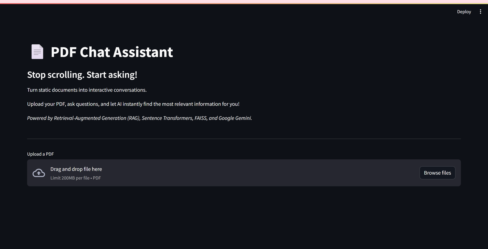
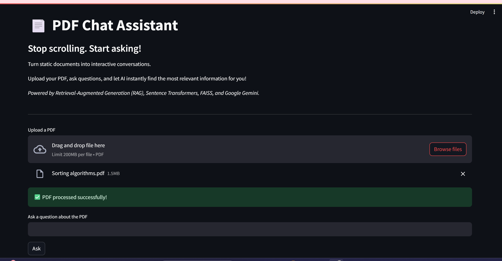
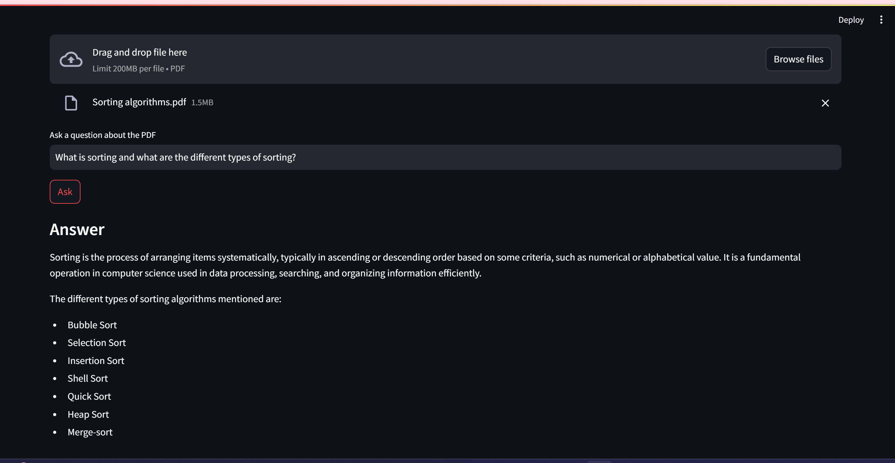

# 📄 PDF Chat Assistant

An AI-powered application that enables users to interact with PDF documents through natural language conversations. The system leverages Retrieval-Augmented Generation (RAG) to retrieve relevant information from uploaded PDFs and generates accurate, context-aware responses using Google Gemini.

## Tech Stack

Built using **Python**, **Streamlit**, **Sentence Transformers**, **FAISS**, and **Google Gemini 2.5 Flash**.

## Features

* **Interactive PDF Question Answering** – Upload PDF documents and query them using natural language.
* **Automated Text Extraction & Preprocessing** – Extracts text from PDFs and performs cleaning for improved downstream processing.
* **Context-Preserving Text Chunking** – Splits documents into overlapping chunks to retain contextual information during retrieval.
* **Semantic Embedding Generation** – Converts text chunks into dense vector representations using **Sentence Transformers (all-MiniLM-L6-v2)**.
* **Efficient Vector Similarity Search** – Retrieves the most relevant document chunks using **FAISS** for fast semantic search.
* **Retrieval-Augmented Generation (RAG)** – Enhances LLM responses by grounding them in retrieved document context.
* **AI-Powered Response Generation** – Generates accurate, context-aware answers using **Google Gemini 2.5 Flash**.
* **Interactive Web Application** – Built with **Streamlit** for an intuitive and responsive user experience.

## Screenshots

### Home Screen


### PDF Upload


### Q & A Demo


## Installation & Setup

### 1. Clone the repository

```bash
git clone <repository-url>
cd pdf-chat-assistant
```

### 2. Install dependencies

```bash
pip install -r requirements.txt
```

### 3. Create a `.env` file

```text
GEMINI_API_KEY=YOUR_GEMINI_API_KEY
```

Generate your own Gemini API key from Google AI Studio and add it to the `.env` file.

### 4. Run the application

```bash
streamlit run app.py
```

## Architecture & Workflow

```text
 Upload PDF
      │
      ▼
Extract Text
      │
      ▼
Split Text into
    Chunks
      │
      ▼
Generate & Store
  Embeddings
      │
      ▼
  User Query
      │
      ▼
Generate Query
  Embedding
      │
      ▼
FAISS Similarity
    Search
      │
      ▼
Retrieve Relevant
    Chunks
      │
      ▼
    Gemini
(Retrieved Context +
    User Query)
      │
      ▼
Generate Grounded
    Response
```

## Project Structure

```text
pdf-chat-assistant/
│
├── app.py                  # Streamlit application
├── requirements.txt        # Project dependencies
├── README.md               # Project documentation
├── .gitignore              # Files ignored by Git
│
├── data/
│   └── sample.pdf            # Sample PDF
│
├── notebooks/              # Development notebooks
│   ├── 01_read_pdf.ipynb
│   ├── 02_chunk_text.ipynb
│   ├── 03_embeddings.ipynb
│   ├── 04_faiss_similarity_search.ipynb
│   └── 05_rag_pipeline.ipynb
│
└── src/
    ├── config.py           # Project configuration
    ├── pdf_utils.py        # PDF text extraction
    ├── text_utils.py       # Text cleaning & chunking
    ├── embeddings.py       # Embedding generation
    ├── vector_store.py     # FAISS index creation and search
    ├── rag.py              # Document retrieval pipeline
    └── llm.py              # Gemini response generation
```
